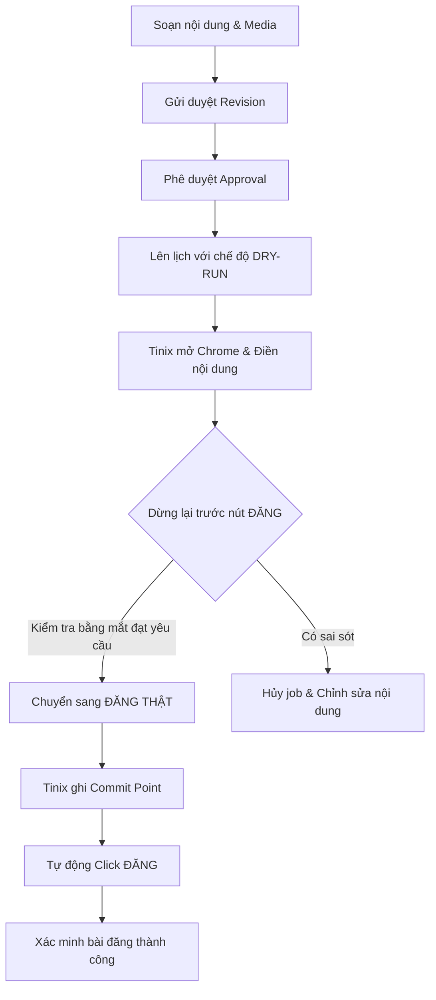

# Hướng dẫn sử dụng Tinix Social Hub

Phiên bản áp dụng: `1.0.44`
Hệ điều hành hỗ trợ: **Windows 10 / 11** (PC-first, Local-first)

---

## Mục lục

1. [Giới thiệu tổng quan](#1-giới-thiệu-tổng-quan)
2. [Yêu cầu hệ thống và Cài đặt](#2-yêu-cầu-hệ-thống-và-cài-đặt)
3. [Khởi động và Dừng ứng dụng](#3-khởi-động-và-dừng-ứng-dụng)
4. [Tổng quan giao diện WebUI](#4-tổng-quan-giao-diện-webui)
5. [Quản lý Tài khoản và Chrome Profile](#5-quản-lý-tài-khoản-và-chrome-profile)
6. [Sáng tạo nội dung và AI Studio](#6-sáng-tạo-nội-dung-và-ai-studio)
7. [Quản lý Kho Media](#7-quản-lý-kho-media)
8. [Lập lịch đăng bài và Khung giờ vàng (Posting Slots)](#8-lập-lịch-đăng-bài-và-khung-giờ-vàng-posting-slots)
9. [Quy trình Dry-run an toàn và Đăng thật](#9-quy-trình-dry-run-an-toàn-và-đăng-thật)
10. [Theo dõi Hàng đợi và Bảng trạng thái Job](#10-theo-dõi-hàng-đợi-và-bảng-trạng-thái-job)
11. [Đối soát số liệu tương tác (Analytics)](#11-đối-soát-số-liệu-tương-tác-analytics)
12. [Cài đặt, Bảo trì và Sao lưu dữ liệu](#12-cài-đặt-bảo-trì-và-sao-lưu-dữ-liệu)
13. [Điều khiển bằng dòng lệnh (CLI) và Local API](#13-điều-khiển-bằng-dòng-lệnh-cli-và-local-api)
14. [Xử lý sự cố thường gặp (Troubleshooting)](#14-xử-lý-sự-cố-thường-gặp-troubleshooting)
15. [Checklist chuẩn bị cho lần chạy đầu tiên](#15-checklist-chuẩn-bị-cho-lần-chạy-đầu-tiên)

---

## 1. Giới thiệu tổng quan

**Tinix Social Hub** (trước đây là Tinix Social Studio) là ứng dụng máy tính dành riêng cho Windows, giúp bạn tập trung quản lý, sáng tạo, phê duyệt, lập lịch và tự động đăng bài lên nhiều nền tảng mạng xã hội:

- **Facebook Page**: Đăng bài viết kèm 1 ảnh, nhiều ảnh hoặc video qua giao diện Web Facebook.
- **Instagram Web**: Đăng ảnh đơn và bộ sưu tập ảnh (Carousel).
- **TikTok Studio**: Đăng video ngắn (Short video) lên TikTok Studio Web.
- **YouTube Studio / API**: Đăng Video chuẩn và YouTube Shorts qua giao diện YouTube Studio hoặc kết nối trực tiếp Google OAuth Data API v3.
- **X (Twitter)**: Đăng tweet văn bản, tối đa 4 ảnh hoặc 1 video.

### Đặc tính cốt lõi:
- **Chạy hoàn toàn cục bộ (Local-first)**: Toàn bộ dữ liệu nằm trên máy tính của bạn (`data/tinix_social.db`), không cần Docker, Redis, Celery, PostgreSQL hay reverse proxy.
- **Mỗi tài khoản một Chrome Profile riêng biệt**: Tránh hoàn toàn tình trạng trùng lặp phiên, dính checkpoint chéo hoặc xung đột tài khoản.
- **Cơ chế Dry-run an toàn**: Tự động mở trình duyệt, điền nội dung, tải ảnh/video lên nhưng **dừng lại trước nút Đăng** để bạn kiểm tra trực quan.
- **Cam kết chống đăng lặp (Anti-duplicate)**: Có cơ chế ghi nhận điểm cam kết (*commit point*); khi gặp sự cố mạng sau khi đã bấm đăng, hệ thống sẽ dừng lại chuyển sang trạng thái chờ đối soát thay vì tự ý đăng lại nhiều lần.

---

## 2. Yêu cầu hệ thống và Cài đặt

### Yêu cầu:
- Hệ điều hành: **Windows 10** hoặc **Windows 11** (64-bit).
- Python: Phiên bản **3.11** trở lên (khuyên dùng Python 3.11 hoặc 3.12, tick chọn *Add Python to PATH* khi cài đặt).
- Trình duyệt: **Google Chrome** (khuyên dùng) hoặc Microsoft Edge bản mới nhất.

### Cấu hình AI (Tùy chọn):
Nếu bạn muốn sử dụng phân hệ **AI Content Studio**, hãy tạo file `.env` ở thư mục gốc (hoặc sao chép từ `.env.example`) và điền API Key:

```env
TINIX_AI_BASE_URL=https://api.deepseek.com
TINIX_AI_MODEL=deepseek-chat
TINIX_AI_API_KEY=sk-your-deepseek-api-key-here
TINIX_AI_TIMEOUT_SECONDS=60
TINIX_AI_MAX_RETRIES=2
```

> [!NOTE]
> Khóa API chỉ được lưu và đọc trực tiếp ở backend trên máy bạn, không bao giờ gửi ra bên ngoài hay lộ xuống giao diện WebUI.

---

## 3. Khởi động và Dừng ứng dụng

Thư mục gốc của dự án được trang bị sẵn các script điều khiển nhanh:

### 1. Khởi động chế độ App Mode độc lập (Khuyên dùng cho người dùng)
Nhấp đúp chuột vào file **`START.bat`** (hoặc mở biểu tượng shortcut **Tinix Social Hub** ngoài Desktop):
- Máy chủ backend chạy ngầm hoàn toàn trong nền thông qua `pythonw.exe`.
- Tự động mở giao diện ứng dụng dưới dạng cửa sổ phần mềm độc lập (**App Mode**, không có thanh nhập URL, không có các tab trình duyệt gây xao nhãng, có icon riêng trên Taskbar).
- Tự động tạo biểu tượng ngoài màn hình Desktop với icon sang trọng nếu chưa có.
- Giao diện truy cập tại địa chỉ: `http://127.0.0.1:8765`.

### 2. Dừng ứng dụng ngầm
Nhấp đúp chuột vào file **`STOP.bat`**:
- Tiến trình máy chủ ngầm sẽ được tắt an toàn, các cổng kết nối và tài nguyên được giải phóng.

### 3. Khởi động kèm Console (Dành cho Lập trình viên / Gỡ lỗi)
Nhấp đúp chuột vào file **`RUN.bat`**:
- Mở cửa sổ dòng lệnh (Terminal) hiển thị trực tiếp toàn bộ log hệ thống thời gian thực.
- Nhấn `Ctrl + C` tại cửa sổ dòng lệnh để dừng ứng dụng an toàn.

### 4. Nâng cấp phiên bản & Tự động Rebuild
Nhấp đúp chuột vào file **`BUILD.bat`** (hoặc chạy lệnh: `.\.venv\Scripts\python.exe build.py`):
- Tự động tăng phiên bản (ví dụ: `v1.0.4` -> `v1.0.5`).
- Biên dịch logo SVG sang bộ icon Windows `.ico` đa kích thước.
- Làm mới shortcut ngoài Desktop.
- Tự động chạy toàn bộ hơn 133+ bài test kiểm thử chất lượng phần mềm.
- Không tự tạo Git commit; chỉ dùng `--commit` khi muốn tạo commit cho bản build đã kiểm tra.

---

## 4. Tổng quan giao diện WebUI

Giao diện quản trị chia thành các phân hệ rõ ràng ở thanh điều hướng bên trái:

| Phân hệ | Chức năng chính |
|---|---|
| **Tổng quan** | Xem nhanh trạng thái hệ thống, biểu đồ phân tích, các tác vụ đăng bài gần đây và bảng ma trận năng lực từng nền tảng. |
| **AI Content Studio** | Trợ lý AI tạo bài viết mới, biến thể nội dung, viết lại, rút gọn, chuẩn hóa theo Brand Profile. *(AI chỉ tạo bản nháp, không tự ý đăng)*. |
| **Kho nội dung** | Quản lý danh sách bài viết, tiêu đề, nội dung caption, hashtag, nút kêu gọi hành động (CTA), lịch sử sửa đổi (revisions) và trạng thái phê duyệt (approval). |
| **Media Library** | Thư viện lưu trữ ảnh, video; tự động loại trừ file trùng bằng mã băm SHA-256; gắn thẻ tag và alt text. |
| **Calendar** | Lịch phát hành theo dạng Tuần / Tháng / Danh sách; cấu hình khung giờ vàng đăng bài (Posting Slots) tự động. |
| **Hàng đợi & Lịch sử** | Theo dõi tiến độ chạy bài đăng từng giây, xem log chi tiết, xem ảnh chụp màn hình khi gặp lỗi, chạy lại an toàn (safe retry). |
| **Analytics** | Thu thập các chỉ số tương tác thực tế từ giao diện trình duyệt (UI-scraped DOM) để đối soát hiệu quả. |
| **Tài khoản & Page** | Quản lý danh sách tài khoản mạng xã hội, mở Chrome profile độc lập, đồng bộ danh sách Fanpage/Kênh, nhập/xuất profile ZIP. |
| **Cài đặt** | Kiểm tra toàn vẹn cơ sở dữ liệu (SQLite integrity check), sao lưu (backup), phục hồi (restore) và cấu hình dọn rác tự động. |

---

## 5. Quản lý Tài khoản và Chrome Profile

### 5.1. Thêm tài khoản mới
1. Mở tab **Tài khoản & Page**.
2. Bấm nút **+ Thêm account**.
3. Điền tên gợi nhớ (ví dụ: `Facebook Doanh Nghiệp`, `TikTok Kênh Chính`).
4. Chọn nền tảng tương ứng: **Facebook, Instagram, TikTok, YouTube, X**.
5. Bấm **Lưu**.

### 5.2. Đăng nhập tài khoản bằng Chrome an toàn
Mỗi tài khoản khi tạo ra sẽ được cấp một thư mục Chrome Profile độc lập tại `chrome_profiles/<MÃ-UUID>`.
1. Trong danh sách tài khoản, bấm nút **Mở Chrome**.
2. Một cửa sổ Google Chrome riêng biệt sẽ mở ra. Bạn tiến hành đăng nhập tài khoản mạng xã hội của mình như thông thường (nhập tài khoản, mật khẩu, xác thực 2 bước 2FA hoặc giải CAPTCHA nếu có).
3. Đăng nhập thành công xong, bạn quay lại giao diện Tinix và bấm **Kiểm tra login**.
4. Khi trạng thái chuyển sang màu xanh **"Đã đăng nhập"**, bấm tiếp nút **Đồng bộ Page/kênh** để Tinix tự động quét các Fanpage hoặc Kênh mà tài khoản đang nắm quyền quản trị.

> [!IMPORTANT]
> Tuyệt đối không đăng nhập nhiều tài khoản mạng xã hội khác nhau vào cùng một profile Chrome của một account trong Tinix để tránh xung đột session và quyền hạn.

### 5.3. Giao diện Master-Detail & Quản lý nâng cao (Mới từ v1.0.4)
- **Đánh dấu sao (⭐ Star account)**: Nhấp vào biểu tượng ngôi sao bên cạnh tài khoản để đưa tài khoản quan trọng lên đầu danh sách.
- **Bộ lọc & Tìm kiếm**: Tìm kiếm nhanh theo tên tài khoản, lọc theo từng nền tảng hoặc lọc theo trạng thái đăng nhập.
- **Lưu trữ thông tin bổ sung**: Ở khung chi tiết bên phải, bạn có thể lưu Username, Email, Mật khẩu, Khóa bí mật 2FA và Ghi chú nội bộ. *(Toàn bộ được lưu cục bộ an toàn, có nút ẩn/hiện mật khẩu tiện lợi)*.

### 5.4. Di chuyển tài khoản giữa các máy tính (Import / Export ZIP)
Bạn có thể mang toàn bộ tài khoản và phiên đăng nhập Chrome sang máy tính khác hoặc chia sẻ với các công cụ trong hệ sinh thái Tinix:
- **Export Account & Sessions ZIP**: Tạo ra file nén `.tinix-profiles.zip` lưu tại thư mục `exports/chrome_profiles/`. File này đóng gói thông tin tài khoản và dữ liệu phiên cần thiết (đã tự động lược bỏ cache rác dung lượng lớn).
- **Import Profiles ZIP**: Đọc file `.tinix-profiles.zip` và tự động tái lập lại tất cả tài khoản cùng phiên đăng nhập trên máy mới trong vòng 1 nốt nhạc.

### 5.5. Dọn dẹp dung lượng Chrome Profile
Trình duyệt Chrome khi dùng lâu ngày thường sinh ra cache rất nặng:
- **Nút "Dọn dẹp profile"**: Bấm để quét và xóa sạch toàn bộ cache rác của Chromium. Chức năng này **giữ nguyên 100%** cookie, trạng thái đăng nhập, Local Storage và IndexedDB.
- **Tự động dọn dẹp**: Vào tab **Cài đặt**, bật tính năng dọn dẹp tự động định kỳ mỗi 6 giờ khi cache vượt ngưỡng (mặc định 5 GB) hoặc khi ổ đĩa còn dưới 10 GB.

### 5.6. Kết nối Official API cho YouTube (Tùy chọn)
Nếu bạn có Google Cloud Console và muốn dùng API chính thức cho YouTube:
1. Điền thông tin vào `.env`:
   ```env
   TINIX_YOUTUBE_CLIENT_ID=your-client-id.apps.googleusercontent.com
   TINIX_YOUTUBE_CLIENT_SECRET=your-client-secret
   TINIX_YOUTUBE_REDIRECT_URI=http://127.0.0.1:8765/api/oauth/youtube/callback
   ```
2. Khởi động lại app, vào **Tài khoản & Page** của kênh YouTube, chọn **Kết nối API** và cấp quyền OAuth.
3. Bạn có thể chọn chế độ:
   - **Ưu tiên API**: Dùng API trước, nếu token hết hạn sẽ tự động chuyển sang dùng Chrome.
   - **Chỉ API**: Tuyệt đối chỉ dùng API, không bao giờ dùng Chrome.

### 5.7. Kết nối Facebook Page API bằng System User token
1. Vào **Cài đặt → Tích hợp**, thêm Meta Developer App, điền App ID và Graph API version rồi bật app. Nếu chỉ dùng System User token, App Secret và Redirect URI có thể để trống.
2. Trong Meta Business Settings, gán Meta App và Page cần quản lý cho System User; tạo token với quyền cần thiết như `pages_manage_posts`, `pages_read_engagement`, `read_insights` và `pages_show_list`.
3. Vào **Tài khoản & Page**, chọn account Facebook rồi bấm **Kết nối Meta API** hoặc **Cập nhật Meta API**. Chọn Meta App, nhập token rồi bấm **Tìm Page bằng token** và đánh dấu các Page muốn kết nối.
4. Nếu Meta không trả danh sách, nhập một hoặc nhiều Page ID dạng số, cách nhau bằng dấu phẩy hoặc xuống dòng. Bấm **Lưu Page đã chọn** để Tinix xác minh từng Page.
5. Một account Tinix có thể quản lý nhiều Page. Để thêm Page bằng token hiện tại, để trống ô token rồi chọn/nhập Page mới. Có thể ngắt riêng từng Page mà vẫn giữ target và dữ liệu lịch sử.

Token được lưu mã hóa cục bộ bằng Windows DPAPI. Trong chi tiết account, nút **Show** có thể hiện lại System User token đã lưu; chỉ dùng trên máy Tinix đang chạy. Kết nối thủ công không cần tunnel. Nếu Meta không trả Page task, quyền được ghi là chưa xác minh và Tinix không bật đăng API. Khi đổi token, xác minh lại Page đang giữ; Page bỏ chọn chỉ bị ngắt sau khi xác nhận. OAuth vẫn dùng được qua nút **Dùng OAuth** nếu App có Secret và Redirect URI HTTPS hợp lệ. Thay đổi token hoặc quyền sẽ yêu cầu dry-run và duyệt lại release API liên quan.

---

## 6. Sáng tạo nội dung và AI Studio

### 6.1. Soạn thảo thủ công trong Kho nội dung
1. Mở tab **Kho nội dung**, chọn **+ Tạo bài**.
2. Nhập tiêu đề nội bộ (dễ phân biệt trong danh sách).
3. Nhập nội dung bài viết (Caption), Hashtag và Lời kêu gọi hành động (CTA).
4. Tải lên ảnh hoặc video trực tiếp vào bài viết.
5. Bấm **Lưu bản nháp**.

### 6.2. Tạo bài viết với AI Content Studio
1. Mở tab **AI Content Studio**.
2. Chọn **System Prompt** để quy định cách AI xử lý nội dung. Bạn có thể thêm, sửa, tắt hoặc xóa prompt ngay bên cạnh dropdown; ứng dụng vẫn tự bảo vệ định dạng JSON đầu ra.
3. Chọn Hồ sơ thương hiệu (Brand Profile) nếu có để giữ đúng tông giọng (tone of voice). Hồ sơ cũng có thể được tạo, sửa hoặc xóa ngay tại đây.
4. Nhập ý tưởng sơ bộ (Brief), chọn ảnh tham chiếu nếu cần và tích chọn các nền tảng mong muốn (Facebook, TikTok, YouTube, X...). AI chỉ nhận ảnh tham chiếu, tối đa 4 ảnh mỗi lần tạo.
5. Bấm **Tạo bản nháp**. Ảnh tham chiếu sẽ được gửi tới text model hỗ trợ vision và tự gắn vào bản nháp. Nếu model không hỗ trợ phân tích ảnh, ứng dụng sẽ báo rõ để bạn bỏ ảnh hoặc đổi model.

### 6.3. Quy trình Phê duyệt (Approval Gate) - Nguyên tắc an toàn
- Khi sửa đổi bất kỳ thông tin nào của bài viết, hệ thống sẽ tự động tăng số bản sửa đổi (**Revision**, ví dụ: Rev 1 -> Rev 2).
- Nếu một bài viết đã được Duyệt (Approved) nhưng sau đó bạn chỉnh sửa lại, trạng thái duyệt sẽ **ngay lập tức bị hủy bỏ**.
- Bạn phải bấm **Gửi duyệt** và thực hiện **Duyệt bài** cho Revision mới nhất trước khi thực hiện đăng thật lên mạng xã hội.

---

## 7. Quản lý Kho Media

1. Mở tab **Media Library**, bấm **+ Upload media**.
2. Chọn hình ảnh (`.jpg`, `.png`, `.webp`...) hoặc video (`.mp4`, `.mov`...).
3. **Cơ chế chống trùng lặp (SHA-256)**: Hệ thống tự động tính mã băm cho từng file. Dù bạn tải cùng 1 file ảnh 10 lần, hệ thống chỉ lưu đúng 1 file vật lý trên đĩa cứng, giúp tiết kiệm tối đa dung lượng.
4. Nhập thẻ Tag và Alt text để dễ dàng quản lý và tối ưu SEO khi đăng bài.
5. **Gắn vào bài viết**: Bạn có thể chọn ảnh/video từ thư viện và bấm "Gắn content" để đưa vào bài nháp.
6. **Bảo vệ chống xóa nhầm**: Nếu một file media đang được sử dụng trong bài viết hoặc lịch đăng bài đang chờ, hệ thống sẽ khóa nút xóa để đảm bảo an toàn.

> [!WARNING]
> Quy tắc định dạng: Không trộn lẫn video và hình ảnh trong cùng một bài đăng. Mỗi bài đăng video chỉ đính kèm 1 file video duy nhất.

---

## 8. Lập lịch đăng bài và Khung giờ vàng (Posting Slots)

### 8.1. Cấu hình Khung giờ vàng (Posting Slots)
Mỗi Fanpage hoặc Kênh thường có các khung giờ vàng tương tác cao khác nhau:
1. Trong tab **Calendar**, mở mục cấu hình **Posting Slots**.
2. Chọn Fanpage/Kênh cần thiết lập và chọn múi giờ (ví dụ: `Asia/Ho_Chi_Minh` hoặc `Asia/Bangkok`).
3. Nhập lịch theo cấu trúc: `<Thứ> <Giờ:Phút>` (mỗi dòng một khung giờ).
   - Quy ước: `0` = Thứ Hai, `1` = Thứ Ba, `2` = Thứ Tư, `3` = Thứ Năm, `4` = Thứ Sáu, `5` = Thứ Bảy, `6` = Chủ Nhật.
   - *Ví dụ mẫu*:
     ```text
     0 09:00
     0 19:30
     2 11:30
     4 20:00
     5 09:00
     6 20:30
     ```
4. Khi lên lịch bài đăng, bạn chỉ cần bấm **Dùng slot kế tiếp**, hệ thống sẽ tự động tính toán và điền thời gian vào khung giờ vàng còn trống gần nhất.

### 8.2. Tạo lịch phát hành bài đăng
1. Vào tab **Calendar**, chọn **+ Lên lịch đăng**.
2. Chọn Bài viết từ Kho nội dung.
3. Chọn Tài khoản và tích chọn một hoặc nhiều Fanpage/Kênh đích.
4. Chọn định dạng bài đăng phù hợp (Post ảnh, Carousel, Video, Short...).
5. Chọn ngày giờ phát hành (hoặc bấm chọn khung giờ vàng).
6. **CHÚ Ý QUAN TRỌNG**: Giữ nguyên tích chọn **Dry-run an toàn** đối với bài đăng thử nghiệm lần đầu!
7. Bấm **Lưu lịch**.

---

## 9. Quy trình Dry-run an toàn và Đăng thật

Đây là tính năng độc đáo và an toàn bậc nhất của Tinix Social Hub.



### Bước 1: Chạy thử an toàn (Dry-run)
- Khi một job ở chế độ Dry-run đến giờ chạy: Worker sẽ mở cửa sổ Chrome của tài khoản đó, truy cập vào trình soạn thảo bài viết của nền tảng, tự động điền caption, hashtag, đính kèm ảnh/video.
- **Worker sẽ DỪNG LẠI và TUYỆT ĐỐI KHÔNG BẤM NÚT ĐĂNG**.
- Trạng thái job trên hệ thống chuyển thành **`dry_run_ready`**.
- Bạn nhìn trực tiếp vào cửa sổ Chrome để kiểm tra: hình ảnh hiển thị đúng chưa, chữ có bị lỗi font không, đúng Fanpage chưa.
- Nếu mọi thứ hoàn hảo, bạn có thể tự tay bấm nút Đăng trên Chrome hoặc đóng cửa sổ.

### Bước 2: Đăng thật có kiểm soát (Real Publish)
Chỉ bỏ tích chọn "Dry-run an toàn" (để đăng thật tự động) khi thỏa mãn đủ các điều kiện:
1. Tài khoản đã ở trạng thái **Đã đăng nhập**.
2. Fanpage/Kênh đích đã được đồng bộ chính xác.
3. Nội dung bài viết đã được **Duyệt (Approved)** ở Revision hiện tại.
4. Đã từng chạy Dry-run thành công cùng loại định dạng trên tài khoản đó.
5. Bạn hoàn toàn sẵn sàng xuất bản nội dung ra công chúng.

> [!CAUTION]
> **Điểm cam kết (Commit Point)**: Khi Worker quyết định bấm nút Đăng, một điểm cam kết được ghi lại trong cơ sở dữ liệu. Nếu vừa bấm xong mà mạng bị rớt hoặc trình duyệt đóng đột ngột, job sẽ chuyển thành `unknown_result` và **KHÔNG BAO GIỜ tự động retry**, tránh trường hợp người dùng bị đăng 2 lần một bài lên mạng xã hội.

---

## 10. Theo dõi Hàng đợi và Bảng trạng thái Job

Mở tab **Hàng đợi & Lịch sử** để giám sát chi tiết các tiến trình:

| Trạng thái | Ý nghĩa | Hành động cần thực hiện |
|---|---|---|
| `scheduled` | Đang chờ đến giờ hẹn | Không cần làm gì, hệ thống sẽ tự chạy khi đến giờ. |
| `queued` | Đang trong hàng đợi chạy | Worker chuẩn bị tiếp nhận xử lý. |
| `opening_browser` | Đang khởi động Chrome profile | Chờ Chrome mở lên. |
| `checking_login` | Đang kiểm tra phiên đăng nhập | Hệ thống tự xác thực session. |
| `uploading` | Đang tải ảnh/video lên composer | Không đóng trình duyệt lúc này. |
| `publishing` | Đang điền nội dung và hoàn thiện | Tuyệt đối không tắt app hoặc can thiệp chuột/phím. |
| `verifying` | Đã bấm đăng, đang đợi xác nhận | Hệ thống chờ tín hiệu bài viết xuất hiện. |
| `dry_run_ready` | **Dry-run thành công** | Trình duyệt đang mở sẵn nội dung; kiểm tra bằng mắt. |
| `succeeded` | **Đăng bài thành công 100%** | Có thể bấm xem URL bài viết trực tiếp trên mạng xã hội. |
| `temporary_failure` | Lỗi tạm thời (ví dụ mạng chập chờn) | Hệ thống sẽ tự thử lại sau một khoảng thời gian giãn cách. |
| `permanent_failure` | Lỗi dứt khoát (ví dụ file media hỏng) | Xem log và ảnh chụp màn hình lỗi để khắc phục. |
| `login_required` | Mất phiên đăng nhập | Bấm "Mở Chrome", đăng nhập lại rồi bấm "Kiểm tra login". |
| `checkpoint` | Bị Facebook/TikTok hỏi CAPTCHA/2FA | Mở Chrome, tự tay vượt checkpoint rồi thử lại. |
| `unknown_result` | Nghi ngờ đã đăng nhưng mất kết nối | Kiểm tra trực tiếp trên Fanpage xem bài đã lên chưa, sau đó bấm **Xác nhận kết quả (Finalize)**. |
| `cancelled` | Job đã bị hủy | Đã dừng tác vụ. |

---

## 11. Đối soát số liệu tương tác (Analytics)

Tinix Social Hub áp dụng giải pháp **UI Scraping qua DOM của Chrome** để lấy số liệu thực tế mà không cần mua các gói API đắt đỏ:
1. Mở tab **Analytics**.
2. Chọn khoảng thời gian (7 ngày, 30 ngày, 90 ngày) và chọn nền tảng cần đối soát.
3. Nếu bài đăng chưa có URL trực tiếp, bấm **Kết nối** và dán đường link bài viết thực tế vào.
4. Bấm nút **Thu thập UI**.
5. Tinix sẽ tự động mở Chrome của tài khoản đó, ghé thăm bài viết và đọc các chỉ số: Lượt xem (Views), Lượt thích (Likes), Bình luận (Comments), Chia sẻ (Shares).
6. Mọi chỉ số đều lưu kèm thời gian thu thập và ảnh chụp selector DOM để đảm bảo tính minh bạch.

---

## 12. Cài đặt, Bảo trì và Sao lưu dữ liệu

### 12.1. Sao lưu định kỳ (Backup)
- Cơ sở dữ liệu SQLite nằm tại: `data/tinix_social.db`.
- Vào tab **Cài đặt**, bấm **Tạo backup ngay** để lưu một bản snapshot vào `data/backups/`.
- Hệ thống luôn **tự động tạo backup an toàn** trước mỗi lần nâng cấp cấu trúc cơ sở dữ liệu (migration).

### 12.2. Khôi phục dữ liệu (Restore)
- Trong tab **Cài đặt**, chọn một bản sao lưu trong danh sách và bấm **Khôi phục**.
- Khi khôi phục, hệ thống tự động kích hoạt chế độ bảo trì (*maintenance mode*), tạm ngưng các tác vụ đang chạy để tránh hỏng dữ liệu, tự tạo một bản backup dự phòng trước khi ghi đè.

### 12.3. Sao lưu toàn bộ ứng dụng sang ổ cứng khác
Để di chuyển toàn bộ công cụ sang máy mới mà không làm mất bất kỳ dữ liệu nào, bạn chỉ cần đóng ứng dụng (`STOP.bat`) và sao chép 4 thư mục/file sau:
1. Thư mục `data/` (chứa database và các bản backup).
2. Thư mục `chrome_profiles/` (chứa toàn bộ phiên đăng nhập Chrome).
3. Thư mục `media/` (chứa toàn bộ hình ảnh và video đã tải lên).
4. File `.env` (chứa cấu hình cá nhân và khóa API).

---

## 13. Điều khiển bằng dòng lệnh (CLI) và Local API

Tinix cung cấp sẵn giao diện dòng lệnh mạnh mẽ để bạn có thể tích hợp với các công cụ tự động hóa khác:

Mở PowerShell tại thư mục dự án:

```powershell
# Xem mã token xác thực bảo mật cục bộ
.\.venv\Scripts\python.exe -m app.cli token

# Kiểm tra trạng thái sức khỏe hệ thống
.\.venv\Scripts\python.exe -m app.cli health

# Xem danh sách các nền tảng được hỗ trợ
.\.venv\Scripts\python.exe -m app.cli platforms

# Xem 20 tác vụ gần nhất
.\.venv\Scripts\python.exe -m app.cli jobs --limit 20

# Lập lịch chạy Dry-run bằng dòng lệnh
.\.venv\Scripts\python.exe -m app.cli schedule `
  --content <CONTENT_ID> `
  --account <ACCOUNT_ID> `
  --targets <TARGET_ID> `
  --format post
```

*(Thêm tham số `--real` nếu muốn lập lịch đăng thật; bài viết bắt buộc phải được duyệt trước).*

---

## 14. Xử lý sự cố thường gặp (Troubleshooting)

### 1. Bấm `START.bat` nhưng trình duyệt không hiện lên?
- **Nguyên nhân**: Cổng `8765` có thể đang bị một ứng dụng khác chiếm giữ hoặc tiến trình cũ chưa tắt hết.
- **Khắc phục**: Nhấp đúp chuột vào **`STOP.bat`**, chờ 3 giây rồi nhấp lại **`START.bat`**. Bạn cũng có thể mở trình duyệt bất kỳ và truy cập thủ công địa chỉ: `http://127.0.0.1:8765`.

### 2. Báo lỗi "Chrome profile is already in use"?
- **Nguyên nhân**: Cửa sổ Chrome của tài khoản đó vẫn đang mở ở chế độ chạy tay hoặc bị treo tiến trình ngầm.
- **Khắc phục**: Tắt tất cả các cửa sổ Chrome đang mở của profile đó, hoặc mở Task Manager (`Ctrl + Shift + Esc`) và kết thúc các tiến trình `chrome.exe` còn sót lại.

### 3. Gặp trạng thái `checkpoint` hoặc `login_required` khi đang chạy bài?
- **Khắc phục**: Vào tab **Tài khoản & Page**, tìm đúng tài khoản bị lỗi và bấm **Mở Chrome**. Tiến hành xác thực mã OTP / 2FA hoặc giải câu đố CAPTCHA trực tiếp trên trình duyệt Chrome. Sau khi tài khoản hoạt động bình thường, bấm **Kiểm tra login** trên Tinix. Khi trạng thái báo xanh, bạn quay lại tab Hàng đợi và bấm **Retry** cho job bị gián đoạn.

### 4. Job chuyển sang trạng thái `unknown_result`?
- **Nguyên nhân**: Mạng Internet bị ngắt đúng lúc Chrome vừa click nút Đăng, hệ thống không kịp nhận phản hồi thành công từ trang web.
- **Khắc phục**: 
  1. Mở trang Fanpage/Kênh đích bằng trình duyệt cá nhân của bạn để xem bài viết thực sự đã lên hay chưa.
  2. Quay lại Tinix, bấm vào chi tiết job đó.
  3. Bấm **Xác nhận kết quả (Finalize)**: Nếu thấy bài đã lên, dán link bài viết và bấm *Xác nhận thành công*; nếu bài chưa lên, bấm *Xác nhận thất bại* để hệ thống giải phóng hàng đợi.

---

## 15. Checklist chuẩn bị cho lần chạy đầu tiên

Dành cho người mới bắt đầu sử dụng phần mềm:

- [ ] Khởi động ứng dụng bằng `START.bat` và truy cập `http://127.0.0.1:8765`.
- [ ] Vào tab **Tài khoản & Page**, tạo tài khoản đầu tiên (ví dụ Facebook Page).
- [ ] Bấm **Mở Chrome**, đăng nhập tài khoản an toàn, sau đó bấm **Kiểm tra login**.
- [ ] Bấm **Đồng bộ Page/kênh** để nạp danh sách Fanpage quản trị.
- [ ] Vào **Kho nội dung**, soạn một bài viết thử nghiệm ngắn kèm 1 hình ảnh.
- [ ] Bấm **Gửi duyệt** rồi bấm **Duyệt bài** cho bản Revision hiện tại.
- [ ] Vào **Calendar**, chọn bài viết, chọn Page đích và **BẬT cờ "Dry-run an toàn"**.
- [ ] Quan sát Chrome tự động mở lên, điền nội dung và dừng lại trước nút Đăng (`dry_run_ready`).
- [ ] Sau khi xác nhận mọi thứ hoạt động trơn tru, bạn đã sẵn sàng cho các chiến dịch tự động hóa đăng bài tiếp theo!

---

*Tài liệu được cập nhật tự động đồng bộ theo các bản build của Tinix Social Hub.*
